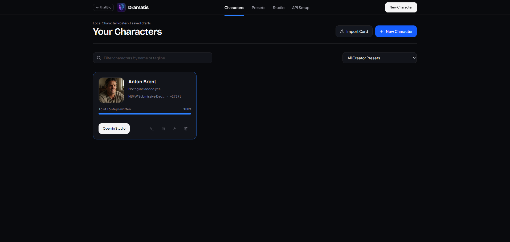
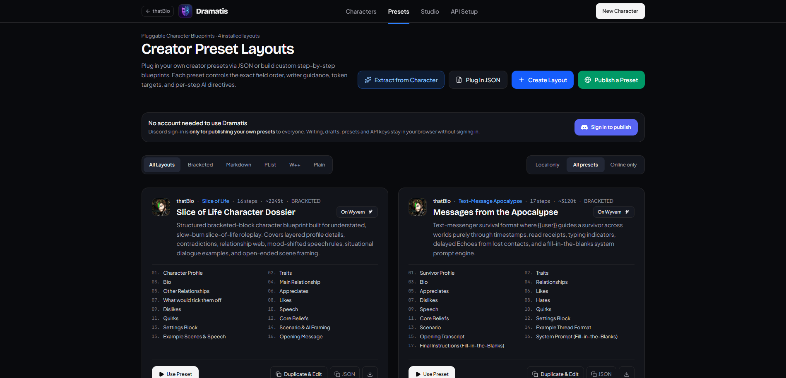
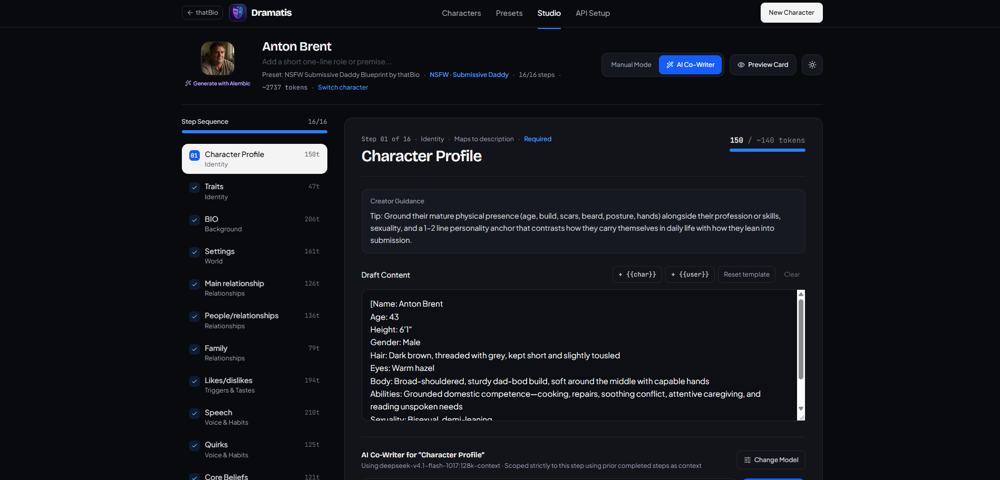

  

<h1 align="center">Dramatis</h1>

Build roleplay characters step by step, the way your favourite bot creators build theirs.

  

---

Dramatis is a character studio for AI roleplay bots. You pick a **creator preset** (a blueprint of a creator's character format, with their field order, writing tips and token targets) and Dramatis walks you through it one step at a time. Write every step yourself, or let an **AI co-writer** draft it with your own API key. At the end you export a finished character card that works on [Wyvern](https://app.wyvern.chat) and any other app that reads Character Card V2.

Have a card from a creator whose style you love? Let Dramatis turn it into a preset, then build your own characters in the same format.

No account is needed. Your characters, presets and API keys stay in your browser.

## What it does

### Characters
- A local roster of all your characters, with progress per character and filters by preset.
- **Import cards** as JSON or PNG character cards (Character Card V2). The portrait comes along.
- **Export** as a PNG character card, Card V2 JSON or Markdown. A PNG card is a normal picture with the whole character hidden inside, so dropping it into an app that supports cards loads the full character.

### Presets

- **Creator presets** set the step order, the writing guidance per step, the token targets and the AI instructions for each step.
- Output layouts: **Bracketed**, **Markdown**, **PList**, **W++** and **Plain**.
- **Extract from Character**: give Dramatis a character card (or one you made) and the AI turns its structure into a reusable preset. This is the quickest way to write like a specific creator.
- **Plug in JSON** or **Create Layout** to build presets by hand, and **duplicate and edit** any preset.
- **Publish a Preset** shares your preset with everyone, with your name, picture and profile link. Discord sign-in is only needed for this one thing; it shows who published the preset.
- A **Local only / All / Online only** switch: local presets are yours and unpublished, online presets are the published ones.

### Studio

- One step at a time, with the creator's tip, a live token count against the step's target, and `{{char}}` / `{{user}}` macros.
- **Manual mode** for writing everything yourself, or **AI Co-Writer** to draft a step from your direction ("make her guarded, with dry humour"). The co-writer only sees the current step and the steps you already finished.
- **Preview Card** shows the finished character in the preset's layout, ready to copy or export.
- **Crop window** for portraits: drag and zoom, with 2:3, 3:4, 1:1 or original framing.

### API Setup
Bring your own key for any OpenAI-compatible API. Built-in shortcuts for [OpenRouter](https://openrouter.ai), [OpenAI](https://platform.openai.com), [DeepSeek](https://platform.deepseek.com) and [Groq](https://console.groq.com), plus local models through [Ollama](https://ollama.com) or [LM Studio](https://lmstudio.ai). Keys are stored in your browser and are sent only to the API you choose.

## Works with Alembic

Dramatis pairs with [Alembic Generative Studio](https://github.com/thatBiologyStudent/alembic-generative-studio) ([try it online](https://thatbio.vercel.app/tools/alembic/)), my bring-your-own-key image studio.

1. In the Studio, click **Generate with Alembic** under the portrait.
2. Alembic opens in portrait mode, with a prompt already written from the character's name and appearance steps and a portrait-sized canvas.
3. Generate until you like one, then press **Use in Dramatis**.
4. The picture comes straight back into Dramatis, where you crop it and it becomes the character's portrait (and the picture in the PNG card).

The two apps talk through the browser window directly. No image goes through a server.

## Run it on your PC

You need Windows and [Node.js](https://nodejs.org) 20.19 or newer. The start script installs Node.js for you through winget if it's missing.

1. Download this repository (green **Code** button, then **Download ZIP**) and unzip it, or clone it with git.
2. Double-click **`Start Dramatis.bat`**.
3. The first start installs the dependencies. After that, your browser opens at http://localhost:3000.

Keep the window open while you use Dramatis; close it to stop. To use another port, set `PORT` before starting.

Good to know about the local version:
- Your characters live in the browser on that PC, separate from the online version. Use Export and Import on the Characters page to move them.
- **Generate with Alembic** opens the online Alembic. Set `VITE_ALEMBIC_URL` to use another copy, such as one running on your PC.
- Publishing presets and the published presets list need the online version, which has the database and Discord sign-in.

On macOS or Linux, run `npm install` and then `npm run dev`.

## Host your own copy

Dramatis is a [Vite](https://vite.dev) + React app with a small Express API. On [Vercel](https://vercel.com) the API runs as a serverless function (`api/index.ts`) and published presets are stored in Postgres (for example [Neon](https://neon.tech)). Without a database, the server keeps published presets in a local `.data` folder, which is fine for testing.

Environment variables (see `.env.example`):

| Variable | What it's for |
|---|---|
| `DATABASE_URL` | Postgres connection for published presets. Leave empty to use the local `.data` store. |
| `DISCORD_CLIENT_ID`, `DISCORD_CLIENT_SECRET` | [Discord OAuth app](https://discord.com/developers/applications) for the publish sign-in. |
| `ADMIN_DISCORD_ID` | Your Discord user ID. Unlocks the review queue for submitted presets. |
| `DISCORD_WEBHOOK_URL` | Optional channel webhook that pings you about new submissions. |
| `APP_URL` | The public URL of your copy, used for the sign-in redirect. |
| `APP_BASE` | Set it when the app runs under a sub-path, such as `/tools/dramatis/`. |
| `VITE_ALEMBIC_URL` | Where **Generate with Alembic** opens. |
| `VITE_BACK_URL`, `VITE_BACK_LABEL` | Optional back link in the header. |

Keep the secrets in your host's environment settings, never in the repository.

## More from me

Dramatis is part of my bot-making toolbox at [thatbio.vercel.app](https://thatbio.vercel.app), next to [Alembic Generative Studio](https://github.com/thatBiologyStudent/alembic-generative-studio), [Bios Background Remover](https://github.com/thatBiologyStudent/bios-background-remover), the [Flow Sidecar Orchestrator](https://github.com/thatBiologyStudent/flow-sidecar-orchestrator) and the [Bing Image Sidecar Orchestrator](https://github.com/thatBiologyStudent/bing-image-sidecar-orchestrator). My characters and worlds are on [Wyvern](https://app.wyvern.chat/profiles/u1yASrRk7FMaaEZlKLZYzYMn36t2).

Made a preset you're proud of? Publish it from the Presets page, so others can build in your style too.
